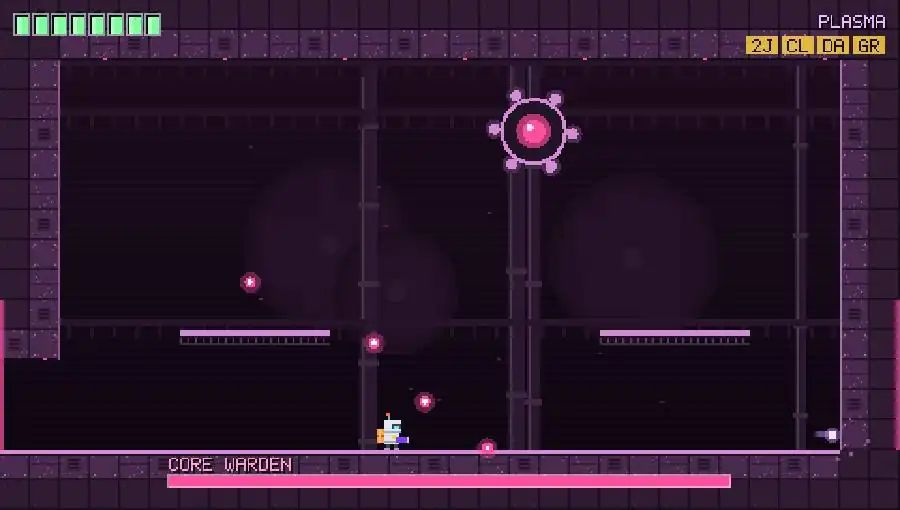
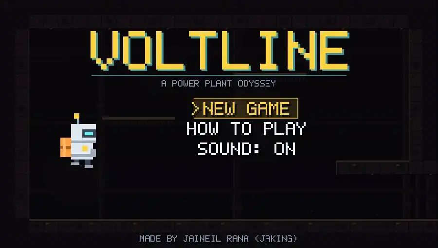
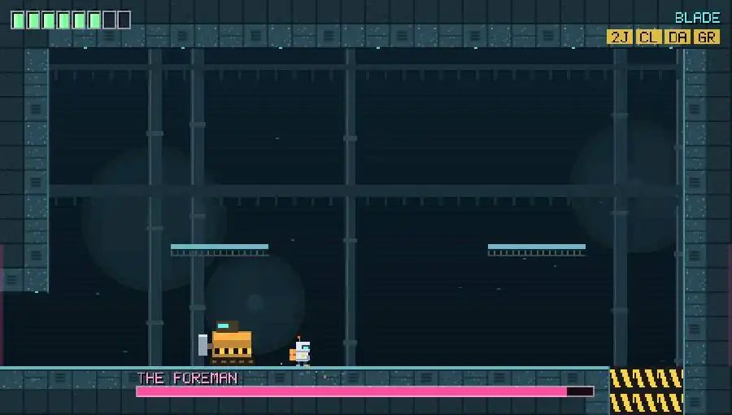
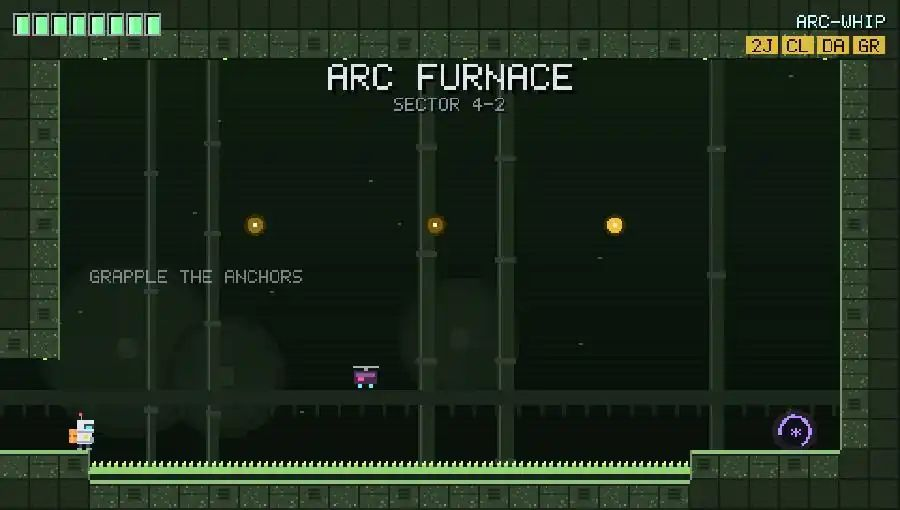
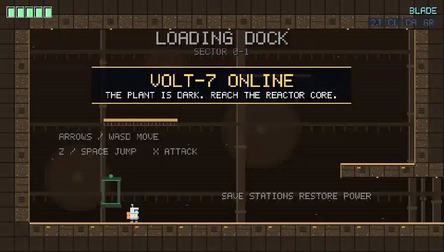
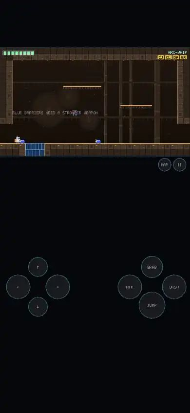

<div align="center">

# ⚡ VOLTLINE ⚡

### A power-plant odyssey: a pixel-art action platformer / mini-metroidvania made with Godot 4

[](https://jaigod.github.io/voltline/play/)

[](https://jaigod.github.io/voltline/)
[](https://godotengine.org/)
[](scripts/)
[](https://github.com/JaiGod/voltline/actions/workflows/pages.yml)
[](LICENSE)



</div>

---

The city's power plant went dark. **VOLT-7**, a small courier robot with an energy blade and a parcel strapped to its back, goes down the maintenance line with one last delivery: **power**.

Explore **15 connected sectors**, from the teal cooling towers to the magenta reactor core. Find abilities that open paths you passed earlier, and shut down the two machines that took the plant: **The Foreman** and the **Core Warden**.

> **[▶ Play Voltline now](https://jaigod.github.io/voltline/play/)** in any modern browser on desktop or phone. You don't need to install anything.

## 📸 Screenshots

| Title screen | The Foreman (boss 1) |
|:---:|:---:|
|  |  |
| **Arc Furnace (grapple puzzle)** | **Loading Dock (start)** |
|  |  |

<p align="center"><br><sub>Phone, portrait: the room sits on top and the touch pad sits below it</sub></p>

## ✨ Features

- 🦿 **Four movement abilities that open new paths:** double jump, wall-climb, dash and grapple. Every ability is needed to reach a part of the plant.
- ⚔️ **A weapon upgrade chain:** energy blade → **arc-whip** (long electric lash that cuts blue barriers) → **plasma launcher** (ranged bolts that melt red plating).
- 👾 **6 enemy types:** sparkbugs, volt drones, turrets, spring hoppers, shield sentries (hit them from behind) and static mines.
- 💀 **2 bosses with two phases each:**
  - **The Foreman** leaps, sends out shockwaves, charges across the room and stuns itself on the walls.
  - **The Core Warden** fires bullet rings, aimed volleys, spirals and sweeping beams, and summons drones.
- ❤️ **3 power cells** (health upgrades) hidden behind ability gates, plus health drops from enemies.
- 🗺️ **A map screen** ("plant schematic") that shows visited rooms, nearby unexplored rooms, save stations, items you have not collected and bosses.
- 💾 **Save stations** restore health and save your progress. Items and opened barriers are saved as soon as you get them.
- 🎮 **Tight controls:** coyote time, jump buffering, variable jump height, apex hang, pogo down-attack, deflecting enemy bolts, hit-stop and screen shake.
- 🎨 **Everything is made in code:** the pixel art, the room textures, the 5×7 pixel font, the sound effects and both chiptune loops. The game has no image or audio files.
- 📱 **Runs everywhere:** keyboard, gamepad, and touch buttons that adapt to portrait or landscape.
- ⏱️ **Stats on clear:** time, items, deaths and your best clear time, which is saved.

## 🎮 Controls

| Action | Keyboard | Gamepad | Touch |
|---|---|---|---|
| Move / aim | ← → ↑ ↓ or WASD | D-pad / left stick | D-pad |
| Jump (hold to jump higher) | `Z` / `Space` | A | JUMP |
| Attack (hold up/down to aim; down in the air = pogo) | `X` / `J` | X | ATK |
| Dash | `C` / `Shift` / `K` | B / RB | DASH |
| Grapple to a glowing anchor | `V` / `L` | Y / LB | GRAB |
| Map | `M` / `Tab` | Back | MAP |
| Pause | `Esc` / `P` | Start | II |
| Drop through a catwalk | ↓ + Jump | ↓ + A | ↓ + JUMP |

## 🗺️ The plant

```
                        ┌────────┐ ┌────────┐ ┌────────┐
 row 0  cooling         │COOLING │─│CATWALK │─│FOREMAN │
        (teal)          │ TOWER  │ │        │ │ BAY  F │
                        └───┬────┘ └────────┘ └───┬────┘
┌────────┐ ┌────────┐ ┌───┴────┐ ┌────────┐ ┌───┴────┐
│LOADING │─│ INTAKE │─│TURBINE │─│ RELAY  │═│BREAKER │  row 1  the works
│ DOCK S │ │  HALL  │ │  HALL  │ │STATION │ │ ROOM S │         (amber)
└────────┘ └───╥────┘ └────────┘ └────────┘ └────────┘
┌────────┐ ┌───╨────┐ ┌────────┐ ┌────────┐ ┌────────┐
│ FILTER │─│  PUMP  │─│ SLUDGE │─│TRANSFRM│─│  ARC   │  row 2  sludge
│ VAULT  │ │STATION │ │CHANNEL │ │ YARD S │ │FURNACE │         (green)
└────────┘ └────────┘ └────────┘ └───╥────┘ └────────┘
                                 ┌───╨────┐ ┌────────┐
 S = save station                │  DEEP  │─│REACTOR │  row 3  reactor
 F / R = bosses                  │CONDUT S│ │ CORE R │         (magenta)
 ═ ║ = sealed until upgraded     └────────┘ └────────┘
```

The in-game map is the exact version: 15 rooms on a 5×4 grid. Each room is defined as ASCII art in [`scripts/rooms.gd`](scripts/rooms.gd).

## 🛠️ Tech stack

| Part | Tech |
|---|---|
| Engine | [Godot 4.3](https://godotengine.org/) with the **Compatibility (GL)** renderer, so it runs on WebGL2 everywhere |
| Language | GDScript (100%) |
| Rendering | `_draw()` immediate-mode pixel art. Each room is pre-baked into an `ImageTexture` from generated tiles with `Image.blit_rect` |
| Physics | A custom tile-based kinematic controller, axis-separated and fixed at 60 Hz, so it behaves the same every run and can be tested |
| Audio | `AudioStreamWAV` buffers synthesized at runtime (square, saw, triangle and noise with envelopes). The music is generated a little each frame, so the game never stalls |
| Saving | JSON in `user://` (IndexedDB on the web) |
| CI/CD | GitHub Actions + [`barichello/godot-ci:4.3`](https://github.com/abarichello/godot-ci): headless smoke test → Web export (threads off) → GitHub Pages |

## 📁 Project structure

```
voltline/
├── project.godot            # 480x272 base resolution, viewport stretch, GL Compatibility
├── export_presets.cfg       # Web preset (thread_support=false, so no COOP/COEP headers are needed)
├── scenes/Main.tscn         # a single Node2D: the whole game is driven from code
├── scripts/
│   ├── main.gd              # state machine, rooms, collisions, combat, saving, input, touch
│   ├── player.gd            # VOLT-7: movement, abilities, weapons, drawing
│   ├── enemy.gd             # 6 enemies + The Foreman + Core Warden (AI and drawing)
│   ├── rooms.gd             # the 15 rooms as ASCII maps + item text
│   ├── art.gd               # pixel font + generated room textures and palettes
│   ├── hud.gd               # HUD, title, how-to, map, pause, death, victory, touch pad
│   └── sfx.gd               # synthesized sound effects + chiptune music
├── tests/smoke_test.gd      # headless test that plays every room, gate and boss
├── web/index.html           # landing page (deployed at the site root)
├── docs/screenshots/        # README images
└── .github/workflows/pages.yml
```

Quick links: [main.gd](scripts/main.gd) · [player.gd](scripts/player.gd) · [enemy.gd](scripts/enemy.gd) · [rooms.gd](scripts/rooms.gd) · [art.gd](scripts/art.gd) · [sfx.gd](scripts/sfx.gd) · [smoke test](tests/smoke_test.gd) · [workflow](.github/workflows/pages.yml) · [Actions runs](https://github.com/JaiGod/voltline/actions)

## 🚀 Run it locally

1. Install **[Godot 4.3](https://godotengine.org/download/archive/4.3-stable/)** (standard build).
2. Clone the repo: `git clone https://github.com/JaiGod/voltline.git`
3. Open `project.godot` in Godot and press **F5**.

Run the headless smoke test:

```bash
godot --headless --path . --import
godot --headless --path . --script res://tests/smoke_test.gd   # prints "SMOKE OK"
```

Export the web build yourself (you need the 4.3 export templates):

```bash
godot --headless --path . --export-release "Web" build/web/index.html
cd build/web && python3 -m http.server 8000   # open http://localhost:8000
```

A demo link jumps straight into any room with every ability, which is handy for testing: [`/play/?room=4,2&w=2`](https://jaigod.github.io/voltline/play/?room=4,2&w=2).

## 📓 Development log

**Day 1: the concept.** I wanted a small metroidvania that you can finish in about 30–45 minutes, where every upgrade changes how you move. A courier robot in a dead power plant fit nicely: the "parcel" it delivers is power, and every area could have its own color theme.

**Single-screen rooms on a grid.** Instead of a scrolling camera, each room is exactly one 30×17-tile screen, and rooms sit on a 5×4 grid. That made room transitions trivial: leave the screen, load the neighbour, shift the player by 480 or 272 px. The map screen also comes for free from the grid. I wrote the rooms as ASCII art and a Python checker verifies that every opening lines up with the neighbouring room. It caught two misaligned shafts.

**Physics I can test.** I skipped `CharacterBody2D` and wrote a small axis-separated tile collider that runs at a fixed 60 Hz. Because the game logic doesn't depend on frame timing, the headless smoke test can "play" the game with scripted inputs. It measures jump heights, crosses the dash gauntlet, chains grapples, climbs walls and beats both bosses.

**Tuning the gates with numbers.** The first version of the Sludge Channel couldn't be crossed even *with* the dash, and the test caught it. The double jump bonks on the low ceiling, so the run plus double jump plus dash landed about 15 px short. I made the spike pits 7 tiles wide and gave the dash a little more distance (320 px/s for 0.18 s). The same test also checks that the gap **can't** be crossed without the dash, so the gate still means something.

**The grapple bug.** The first grapple kept re-grabbing the anchor it had just reached, so the player hovered there forever. The fix: remember the last anchor for 0.7 s, ignore anchors behind you, and leave the anchor with forward and upward momentum so grapples chain smoothly.

**Game feel.** Coyote time (0.1 s), a jump buffer (0.13 s), variable jump height (lighter gravity while you hold jump and are rising), a small apex hang, hit-stop on every hit, screen shake, dash after-images and a pogo bounce on down-attacks. Shield sentries teach you to jump over them. Enemy bolts can be slashed out of the air, so you can defend yourself even with the starter blade.

**All art from code.** Room textures are baked once per room with `Image.blit_rect`. Three generated panel tiles get auto-tiled edge highlights, plus spikes, catwalks and a background with silhouettes of turbines, pipes and girders drawn into the image. Animated parts (energy barriers, red plating, cracked walls, boss gates, save stations) are drawn live every frame. The font is a hand-made 5×7 bitmap stored as bit rows and turned into an atlas texture at startup.

**Sound without files.** The effects are short pitch-swept tones with noise and envelopes. The two music loops (explore at 112 BPM, boss at 140 BPM) are made from a triangle bass, a pulse arpeggio and noise drums. They are synthesized in chunks of 6000 samples per frame, so the title screen never freezes on slow phones.

**Phones.** The viewport keeps its 480 px width and stretches vertically. On a tall phone the room sits near the top and a big touch pad takes the empty space below it. In landscape, the buttons become see-through and overlay the corners. Touch events go through `Input.action_press`, so the game code can't tell touch from keyboard.

**Web export.** It's exported with `thread_support=false`, so GitHub Pages can host it without COOP/COEP headers, and it uses the Compatibility renderer for WebGL2. CI runs the smoke test, exports the web build, and deploys the landing page at `/` and the game at `/play/`.

**Beta tested on the live site ✅ (Nov 5, 2026).** After the first deploy I played the real GitHub Pages build in a browser: `/play/` boots past the loading bar to the title screen, New Game starts in the Loading Dock, running, jumping and slashing all respond, the next room loads, and the pause menu opens. There were no console errors.

## 🔗 Links

- ▶ **Play:** <https://jaigod.github.io/voltline/play/>
- 🏠 **Landing page:** <https://jaigod.github.io/voltline/>
- 💻 **Source:** [`scripts/`](scripts/) · [`tests/`](tests/) · [`web/`](web/)
- ⚙️ **Builds:** [GitHub Actions](https://github.com/JaiGod/voltline/actions)
- 🏢 **JaiGod org:** <https://github.com/JaiGod>, where you can browse every game
- 🎲 **More JaiGod games:** [browse the repositories](https://github.com/orgs/JaiGod/repositories)
- 🧰 Built with [Godot Engine](https://godotengine.org/) and [godot-ci](https://github.com/abarichello/godot-ci)

## 📄 License

[MIT](LICENSE) © 2026 Jaineil Rana

---

<div align="center">

Made by Jaineil Rana (JaKing) · part of [JaiGod](https://github.com/JaiGod)

</div>
